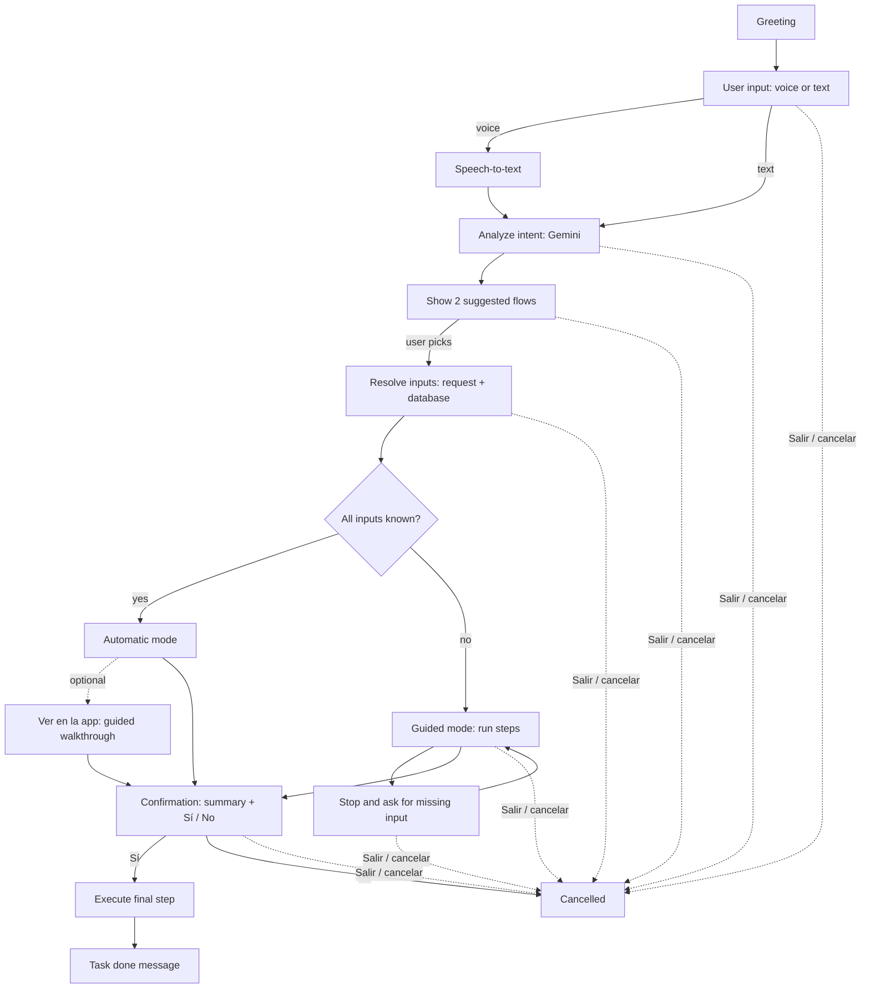

# hackathon-5 · Asistente IA en la app PagoDirecto

Asistente de IA **dentro de la app PagoDirecto** que atiende al usuario por voz y
chat y ejecuta las funciones de la app (pagar servicios, estacionamiento, donar,
enviar fondos), reemplazando el salto del avatar **Wisi** a WhatsApp.

El repo reúne **dos tracks complementarios** del mismo objetivo:

| Track | Qué aporta | Carpetas |
|---|---|---|
| **App MVP** (Flutter + Supabase + Gemini) | App completa, flujos guiados "Ver en la app", intención con Gemini, ejecución server-side | `app/`, `supabase/` |
| **WisiVoz** (gateway + voz ElevenLabs + REA) | Agente de voz real (ElevenLabs Conversational AI), gateway de tools con flujo seguro, y la ingeniería inversa de la app | `backend/`, `agent/`, `web/`, `flutter/wisi_voz/`, `docs/` |

Comparten el mismo principio de seguridad: **el modelo nunca ejecuta dinero**; el
paso final siempre pasa por confirmación y por checks server-side.

---

MVP of an **AI task assistant inside the PagoDirecto app**. The user tells the
mascot what they need, by voice or text, and the assistant runs the right app
flow for them: automatically when it has all the data, step by step when it
needs input. It always asks for confirmation before the final step.

Stack: Flutter (Dart) app · Supabase (Postgres + Edge Functions in TypeScript) ·
Gemini (intent analysis) · ElevenLabs (voice).

```
app/        Flutter app (Android, iOS, web)
supabase/   SQL schema, RLS policies and seed data
```

---

## Run the app

```bash
cd app
flutter pub get
flutter run                                   # mock data
flutter run --dart-define-from-file=env.json  # connected to Supabase
```

`app/env.json` (git-ignored, see `env.example.json`) holds the Supabase project
URL and **publishable** key. Never put the service_role key, Gemini key or
ElevenLabs key in the app; those live in Edge Function secrets.

Without Supabase config the app runs on **mock data** (`lib/data/mock_data.dart`)
that matches the reference screens. Set `MockData.showSampleData = true` to see
filled lists.

### Supabase setup (MVP, no login)

1. Supabase dashboard → **SQL Editor** → run `supabase/schema.sql`.
2. **Authentication → Sign In / Providers → enable "Allow anonymous sign-ins"**.
3. In `main.dart`, call `Supabase.instance.client.auth.signInAnonymously()` when
   there's no session. The user never sees a login. They get a real user id,
   the `handle_new_user` trigger creates their profile and wallet, and row
   level security keeps working unchanged. The session persists on the device.
4. Seed demo data for that user (balance, registered services, pending
   payments) from the SQL Editor so the assistant has something to act on.

---

## AI assistant

### What the user experiences

1. Taps the mascot. The assistant **greets** them ("¡Hola! ¿En qué te ayudo hoy?").
2. Says or types what they need ("Págame el Movistar de este mes").
3. The assistant **analyzes** the request and shows **two suggested flows**
   ("Pagar factura Movistar" / "Programar pago Movistar").
4. The user picks one and the **flow starts**:
   - **Automatic**: every input is already known (from the request or the
     database). The assistant does the work itself. A **"Ver en la app"**
     option lets the user watch it happen: the app navigates screen by screen
     and highlights each step, like an interactive onboarding.
   - **Guided**: some inputs are missing. The assistant runs the flow and
     **stops to ask** for each missing input (by voice, text, or by
     highlighting the field on screen), then continues.
5. **Before the final step, it always asks for confirmation**, with a summary
   ("Vas a pagar Bs. 380,00 a Movistar, cuenta 0414-…. ¿Confirmas?").
6. When the task finishes, it **tells the user it's done** and shows the result.

**At any moment the user can exit**: a "Salir" button is always visible, and
saying "cancelar", "salir" or "detener" ends the flow. Nothing is lost or
half-done, because only the final, confirmed step changes data (see the rules
below).

### Flow



### Non-negotiable rules (enforced in code, not by the AI)

| Rule | How |
| --- | --- |
| Always confirm before the final step | The app's state machine can only reach `executing` through `confirming`. The `assistant-execute` Edge Function rejects any call without a confirmation token issued for that exact session + summary. The AI can't skip it, even if the user said "hazlo directo". |
| The user can exit at any moment | Every state accepts a `cancel` event. Exit stays visible in chat and in "Ver en la app" mode. Voice keywords are checked locally before anything goes to the AI. |
| Exiting never leaves things half-done | Steps before the final one only **read and prepare** data. The final step is the only one that writes (payment, transfer, etc.), and it runs server-side in one transaction. |
| The AI never invents data | Gemini only returns a flow id + extracted parameters. Amounts, accounts and balances always come from the database or from the user, and are shown in the confirmation summary. |

### Architecture

```
Flutter app                          Supabase Edge Functions (TypeScript)      External
──────────────────────────           ──────────────────────────────────────    ─────────────
AssistantScreen (chat + mic)  ──▶    assistant-transcribe  ──────────────────▶  ElevenLabs STT
AssistantController (state)   ──▶    assistant-analyze     ──────────────────▶  Gemini
FlowRegistry (what flows exist)      assistant-execute     ──▶ Postgres (service role)
GuidedTour (Ver en la app)    ◀──    assistant-speak (opt) ──────────────────▶  ElevenLabs TTS
```

- **Why Edge Functions:** API keys stay server-side (`supabase secrets set
  GEMINI_API_KEY=… ELEVENLABS_API_KEY=…`), and the final write happens with
  server-side checks.
- **ElevenLabs vs Gemini:** use ElevenLabs for **voice** (speech-to-text for
  the user's audio, optional text-to-speech so the mascot talks back) and
  Gemini for **understanding** (picking the flow and extracting parameters).
  For a lighter MVP, Gemini alone can take the audio directly and skip the STT
  call; ElevenLabs is then only needed for the spoken replies.

### Flow registry

Each assistant flow maps to a real app feature. It's defined once in Dart
(`lib/assistant/flows.dart`), and a compact copy is sent to Gemini so it can
only choose flows that exist.

```dart
AssistantFlow(
  id: 'pay_service',
  title: 'Pagar un servicio',
  description: 'Paga una factura de telefonía, internet o luz.',
  inputs: [
    FlowInput('service_id', source: InputSource.requestOrUser),     // "Movistar"
    FlowInput('account_ref', source: InputSource.database),         // user_services
    FlowInput('amount', source: InputSource.database),              // payments (pending)
  ],
  steps: [
    FlowStep('select_service', route: '/servicios', highlight: 'serviceList'),
    FlowStep('review_amount',  route: '/servicios/pagar', highlight: 'amountField'),
    FlowStep('pay', isFinal: true),                                 // needs confirmation
  ],
)
```

MVP flows (from the Home screen):

| Flow id | App feature | Typical request |
| --- | --- | --- |
| `pay_service` | Mis pagos / Servicios | "Paga mi Movistar" |
| `schedule_payment` | Mis pagos → Programados | "Programa el pago de Digitel el 15" |
| `pay_parking` | Estacionamiento | "Paga el estacionamiento del Sambil" |
| `pay_parking_meter` | Parquímetros | "Paga el parquímetro por 1 hora" |
| `send_wallet` | Enviar Wallet | "Envíale 50 bolívares a @juan" |
| `deposit` | Depositar | "Quiero recargar mi saldo" |
| `buy_insurance` | Seguros | "Quiero asegurar mi moto" |
| `buy_tickets` | Boletería | "Compra 2 entradas para el concierto" |
| `donate` | Donaciones | "Dona 100 Bs a la fundación" |
| `check_movements` | Movimientos (read-only, no confirmation needed) | "¿Cuánto gasté esta semana?" |

### Analyze contract (`assistant-analyze`)

Request: `{ "text": "págame el movistar de este mes", "session_id": "…" }`

Gemini is called with **structured output** (JSON schema), the flow registry
and a short system prompt ("Choose the 2 most likely flows. Only use the given
flow ids. Extract only parameters the user actually said."). Response:

```json
{
  "suggestions": [
    { "flow_id": "pay_service",      "confidence": 0.86, "params": { "service_id": "movistar" }, "reason": "Pide pagar Movistar ahora" },
    { "flow_id": "schedule_payment", "confidence": 0.41, "params": { "service_id": "movistar" }, "reason": "Podría querer programarlo" }
  ],
  "reply": "Puedo ayudarte de dos formas:"
}
```

If confidence is low for both, the assistant asks a clarifying question
instead of suggesting flows.

### Assistant state machine

```
greeting → listening → analyzing → choosingFlow → resolvingInputs
   → running(step) ⇄ waitingForInput(field)
   → confirming → executing → done
any state → cancelled        any state → error (with "Reintentar" / "Salir")
```

`AssistantController` (a `ChangeNotifier`, replacing the stub in
`lib/data/assistant_service.dart`) owns this state. The chat UI and the
"Ver en la app" overlay both just render it.

### "Ver en la app" (guided walkthrough)

- Each `FlowStep` names a `route` and a `highlight` key. Widgets that can be
  highlighted get a `GlobalKey` registered in a small `TourTargets` map.
- The walkthrough pushes the route, waits for the frame, then draws an overlay
  with a cut-out around the target and a caption bubble from the mascot
  ("Aquí elijo Movistar…"). It auto-advances in automatic mode and waits for
  the user's input in guided mode.
- The overlay always shows **Salir** and **Pausar**.
- Package option: [`showcaseview`](https://pub.dev/packages/showcaseview), or a
  custom `OverlayEntry` + `CustomPainter` (gives more control over pacing).

### Implementation steps

1. **Anonymous session**: steps 2–4 of *Supabase setup* above.
2. **Session log table**: add `assistant_sessions (id, user_id, transcript,
   suggestions jsonb, chosen_flow, status, confirmed_at, finished_at)` with
   RLS on `user_id`. Useful for debugging and for the demo.
3. **Flow registry**: `lib/assistant/flows.dart` with the flows above. Start
   with 2 end-to-end flows (`pay_service`, `schedule_payment`) and add the
   rest once the pipeline works.
4. **`assistant-analyze` Edge Function**: Gemini call with structured output.
   Test it with `curl` before touching the UI.
5. **AssistantController + chat UI**: greeting, text input, the 2 suggestion
   cards, input stops, the confirmation card (summary + "Sí, confirmar" /
   "No"), the done message, and a persistent "Salir".
6. **Input resolution**: for each `FlowInput`, take it from the analyzed
   params, then the database (`user_services`, `payments`, `wallets`…), else
   mark it as a stop. All known → automatic mode; otherwise guided.
7. **`assistant-execute` Edge Function**: one handler per final step. It
   verifies the confirmation token, re-checks balance and amounts server-side,
   writes `payments` / `movements` / `wallets` in one transaction, and returns
   the receipt.
8. **Voice in**: record with [`record`](https://pub.dev/packages/record),
   upload to `assistant-transcribe` (ElevenLabs STT), and feed the text into
   step 4. Check exit keywords locally first.
9. **Voice out (optional)**: `assistant-speak` (ElevenLabs TTS) → play with
   [`just_audio`](https://pub.dev/packages/just_audio). The mascot uses the
   `awake` mood while speaking.
10. **"Ver en la app"**: tour targets + overlay, wired to the same steps.
11. **Demo script**: test the happy path, a request with missing input, saying
    "No" at confirmation, "cancelar" mid-flow, and an unclear request.

### Example conversation

> **Asistente:** ¡Hola! ¿En qué te ayudo hoy?
> **Usuario (voz):** Págame el Movistar.
> **Asistente:** Puedo ayudarte de dos formas: **Pagar factura Movistar** · **Programar pago Movistar**
> **Usuario:** *(toca "Pagar factura Movistar")*
> **Asistente:** Tengo todo lo necesario. Lo hago por ti. *[Ver en la app]*
> **Asistente:** Vas a pagar **Bs. 380,00** a **Movistar** (cuenta 0414-•••-21) desde tu saldo PagoDirecto. ¿Confirmas? *[Sí, confirmar] [No]*
> **Usuario:** Sí.
> **Asistente:** ¡Listo! Pagaste tu factura de Movistar. Te dejé el comprobante en Movimientos.

---

## Where things live

| Path | What |
| --- | --- |
| `lib/screens/main_shell.dart` | Bottom nav tabs + mascot (mood per tab, sleeps when idle) |
| `lib/screens/home_screen.dart` | Wallet cards, Club, Mis pagos, Funciones, Sugerencias |
| `lib/screens/movements_screen.dart` | Movimientos with Todos/Ingresos/Egresos + period filter |
| `lib/screens/payments_screen.dart` | Mis pagos: Pendientes / Programados / Pagados |
| `lib/screens/assistant_screen.dart` | Chat opened from the mascot |
| `lib/data/assistant_service.dart` | Stub reply. Replaced by `AssistantController` (step 5) |
| `lib/screens/placeholder_screen.dart` | "Próximamente" page every unbuilt button opens |
| `lib/data/repository.dart` | Data interface + mock implementation |
| `lib/data/supabase_repository.dart` | Supabase implementation |
| `supabase/schema.sql` | Tables, RLS, new-user trigger, seed data |

---

## WisiVoz — gateway de voz (ElevenLabs Conversational AI) + REA

Track paralelo centrado en una **voz real de agente** y en la ingeniería inversa
de la app. Útil como back-end de tools y como demo de voz end-to-end.

| Carpeta | Qué es | Lenguaje |
|---|---|---|
| `backend/` | Gateway WisiVoz: contrato de tools + ledger simulado + flujo intención→confirmación | Python (FastAPI) |
| `agent/` | Agentes de ElevenLabs (voz Wisi es-VE) + aprovisionamiento | JSON + Python |
| `web/` | Consola demo | React + TypeScript |
| `flutter/wisi_voz/` | Widget que sustituye el handoff a WhatsApp | Flutter/Dart |
| `docs/` | Ingeniería inversa (REA) y decisión técnica | — |

### Webapp de voz funcional (una sola URL, sin túnel)
```bash
cd backend
uv venv && uv pip install -e . && uv pip install pytest httpx
uv run pytest -q                                   # 9 tests del flujo seguro
uv run uvicorn app.main:app --port 8000
cd .. && uv run --project backend python agent/provision_client_tools.py  # crea agentes es-VE
# abre http://localhost:8000/      webapp móvil nueva (voz + chat con el agente, confirmación biométrica)
# abre http://localhost:8000/demo  webapp anterior
```
Requiere `ELEVENLABS_API_KEY` en `backend/.env` (ver `.env.example`).
Despliegue público en `https://botflow.lat` con Cloudflare Tunnel: ver [docs/05-despliegue-cloudflare.md](docs/05-despliegue-cloudflare.md).

### Ingeniería inversa (REA)
- `docs/01-mapa-rea-app.md` — mapa de la app PagoDirecto (Flutter, backend, mapa feature→tool).
- `docs/02-arquitectura.md`, `docs/03-decision.md` — arquitectura y decisión.
- `docs/04-rea-grok.md` — análisis de **Grok Bot** (agente de xAI) y patrones reutilizables.

### Seguridad
El agente **nunca ejecuta dinero**: las tools `prepare_*` crean una intención con
vigencia; la ejecución pasa por la UI autenticada (biometría/PIN → `POST
/api/confirm`), con idempotencia y autorización server-side.
