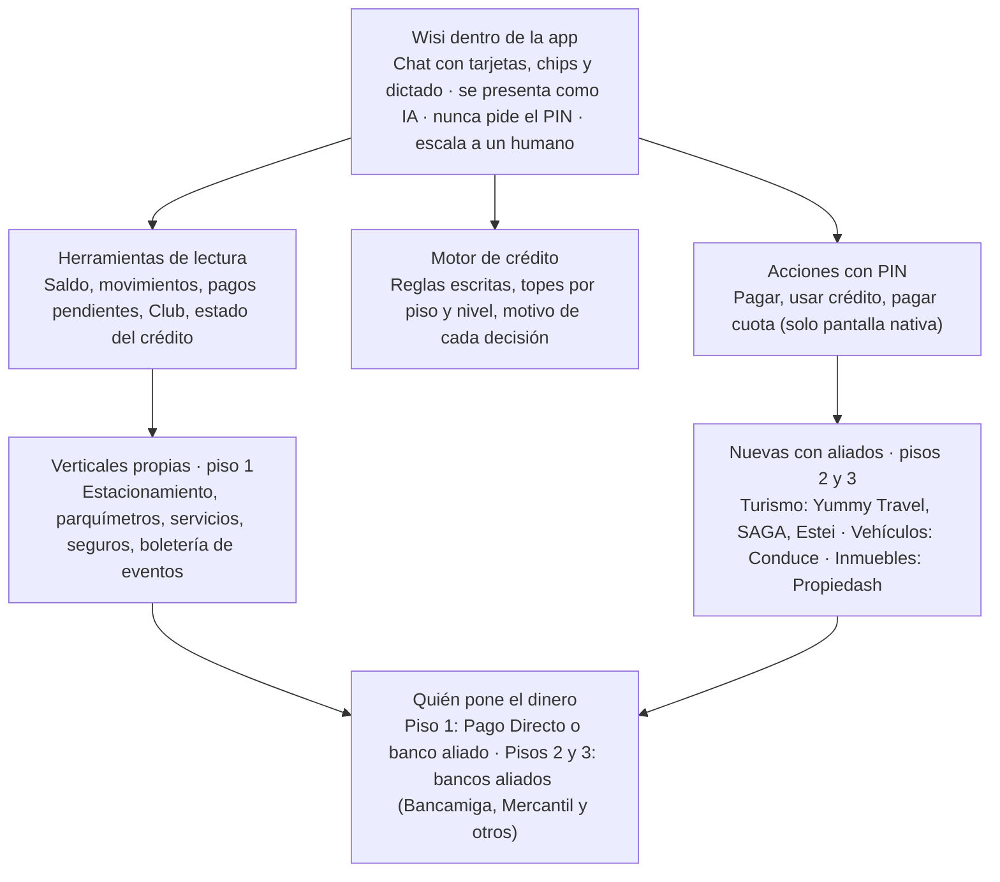
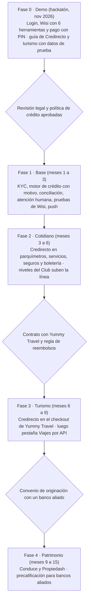

# Pago Directo: ecosistema de crédito y Wisi — informe y roadmap

Oct 31, 2026 · @Andres

## Resumen

Pago Directo puede ofrecer crédito para todo su ecosistema sin crear servicios nuevos, con Wisi dentro de la app como la forma de usarlo. El orden recomendado: primero el crédito cotidiano en lo que ya existe, luego turismo con Yummy Travel, y al final carros con Conduce y casas con Propiedash, prestados por bancos aliados.

- **Hecho:** el modelo más cercano es [Grab PayLater](https://www.grab.com/sg/consumer/finance/paylater/): una superapp que da crédito para todo su ecosistema, con límite según el gasto en la app y 6 meses de antigüedad como requisito.
- **Hecho:** [Propiedash](https://propiedash.com/faq) y [Conduce](https://conduceapp.com/financiamiento) no prestan. Conduce lista 8 bancos con crédito vehicular, entre ellos Bancamiga y Mercantil, que ya son aliados de Pago Directo.
- **Hecho:** [Yummy Travel](https://www.yummysuperapp.com/) vende vuelos de más de 40 aerolíneas sin cuotas. Nadie financia viajes hoy en Venezuela.
- **Propuesta:** una línea Credirecto con tres pisos. Cotidiano (fondea Pago Directo, 7 a 14 días), turismo (cuotas quincenales) y patrimonio (presta un banco, Pago Directo es el canal).
- **Propuesta:** Wisi atiende y explica, un motor de reglas decide y el PIN confirma. El modelo de lenguaje nunca aprueba crédito ni mueve dinero.
- **Primer paso:** el demo del hackatón (fase 0). Luego, revisión legal antes de prestar más allá del estacionamiento.

SAGA está en desarrollo y el contenido de Estei no se pudo leer. Tampoco se pudo verificar la normativa de SUDEBAN y BCV. Los informes anteriores siguen disponibles: [v1](https://claude.ai/artifact/9E3erJ7r717kGZ4fK6q2Xp) y [v2](https://claude.ai/artifact/5MYPX4uh9jZQ9cibZm5vVn).

## Visión del ecosistema

Pago Directo no tiene que crear servicios nuevos: suma tres verticales de aliados que ya existen y les pone encima su crédito y su asistente. Wisi atiende, un motor de reglas decide y los aliados ponen el inventario. Es una propuesta propia.

El modelo de lenguaje solo toca la capa de Wisi y las herramientas de lectura. El motor de crédito y las acciones con PIN son código del servidor que el modelo no puede saltarse.

## Casos de referencia

El caso más parecido a lo que quiere Pago Directo es Grab PayLater. Una superapp da crédito para todo su ecosistema, con un límite que sale del historial de gasto del usuario dentro de la app. Para los créditos grandes (casa, carro, viaje), los casos se repiten: la plataforma no presta con su dinero, presta un aliado que sí puede. Cada columna dice si es hecho o inferencia: "Cómo funciona" y "Requisitos" son hechos de la fuente; "Por qué" es hecho solo cuando va entre comillas; "Ventaja para Pago Directo" es inferencia.

**Asistentes: cómo atienden**

| Caso | País | Cómo funciona | Requisitos | Por qué así | Ventaja para Pago Directo |
| --- | --- | --- | --- | --- | --- |
| [Bank of America Erica](https://info.bankofamerica.com/en/digital-banking/erica) | EE. UU. | Dentro de la app: Zelle, bloquear tarjeta, programar pagos, recordatorios de facturas. Mismas confirmaciones que la app. Escala a un especialista | App 7.6 o superior. Solo en inglés | "Elige la respuesta más adecuada de un conjunto predefinido". No usa IA generativa | Con dinero, la precisión vale más que la creatividad. Wisi debe sacar montos solo de la base de datos |
| [Wells Fargo Fargo](https://sites.wf.com/fargo/) | EE. UU. | Pagos, transferencias, Zelle, apagar tarjeta, pronóstico de saldo a 30 días | Cuentas personales, app móvil. Inglés y español | Inferencia: atender a su base hispana | Un pronóstico de saldo en Bs («¿me alcanza para CANTV el 15?») es muy útil con inflación |
| [Capital One Eno](https://www.capitalone.com/digital/tools/eno/) | EE. UU. | Alerta por SMS de compras sospechosas, cobros recurrentes y pruebas gratis | Cliente de Capital One | Inferencia: el fraude se ataja mejor avisando en el momento | Alerta de cobro raro en el Reto 3 |
| [Klarna](https://www.klarna.com/international/press/klarna-ai-assistant-handles-two-thirds-of-customer-service-chats-in-its-first-month/) | Suecia | Asistente de soporte con OpenAI. Atendió 2/3 de los chats en su primer mes. Menos de 2 min frente a 11 | El cliente puede pedir un humano | Costos: equivale a 700 agentes. +40 M USD estimados (27 feb 2024) | El soporte dentro de la app baja costos, siempre con salida a un humano |
| [bunq Finn](https://press.bunq.com/258930-bunq-launches-smarter-more-powerful-upgrade-to-genai-financial-assistant/) | Países Bajos | 97 % de la actividad de soporte. 47 s por consulta. 38 idiomas | Cliente de bunq | Lo complejo va a un especialista | Separar lo simple (Wisi) de lo complejo (humano) |
| [Monzo Ops Agent](https://monzo.com/blog/engineering-the-future-of-customer-operations-the-monzo-ops-agent) | Reino Unido | Bloquea tarjetas, busca reembolsos, repone tarjetas. Si salta una barrera, pasa a humano | — | "Al inicio, un humano revisaba cada mensaje" antes de enviarlo | Lanzar Wisi con revisión humana de una muestra de conversaciones |
| [Banesco DANI](https://www.banesco.com/atencion-al-cliente/dani/) | Venezuela | Web y app, 24/7. Saldos en VES y divisas, desbloqueo de claves, anular tarjeta | Valida identidad al inicio | — | El usuario venezolano ya conoce un asistente bancario. Wisi debe hacer más: pagar y dar crédito |
| [Bradesco BIA](https://banco.bradesco/como-usar/conheca-bia.shtm) | Brasil | App (voz o texto) y WhatsApp. Pix, boletos, límite de tarjeta, avisos de transacciones sospechosas | Cliente Bradesco | "La BIA no hace llamadas": antiestafa | Wisi debe decir que nunca pide el PIN ni llama |
| [Nubank, Pix por voz](https://blog.nubank.com.br/pix-por-audio-mensagem/) | Brasil | Dices "10 reales para João", revisas, confirmas y pones la clave de 4 dígitos | Límites de día y noche | "Siempre eres tú quien confirma la transacción" | Voz para pedir y PIN para confirmar |

**Crédito: cómo prestan**

| Caso | País | Cómo funciona | Requisitos | Por qué así | Ventaja para Pago Directo |
| --- | --- | --- | --- | --- | --- |
| [Grab PayLater](https://www.grab.com/sg/consumer/finance/paylater/) | Singapur | Paga cualquier cosa en Grab y divídelo en 4, 8 o 12 meses, o todo el mes siguiente. Sin interés. Comisión de 15 SGD por atraso. 0,5 % en puntos | 6 meses como usuario, 18 años o más, cuenta verificada. Límite "personalizado" según el gasto en Grab | "Totalmente transparente y sin interés" y "gasto responsable" | Es el modelo de "crédito para todo el ecosistema". Pago Directo tiene el mismo dato: el historial de pagos dentro de la app |
| [Nubank, Pix no crédito](https://blog.nubank.com.br/pix-no-credito/) | Brasil | Envías un Pix con el límite de la tarjeta. El receptor cobra al instante y tú pagas hasta en 12 cuotas | Límite disponible. Cobran tasas e IOF | Inferencia: el crédito llega a cualquier comercio que acepte Pix | Equivale a "pago móvil a crédito" para pagar servicios |
| [Upstart](https://www.upstart.com/our-story) | EE. UU. | Préstamos personales. 91 % sin intervención humana. Más de 3.000 variables | Solicitud en línea | "41 % más aprobaciones" frente a un modelo tradicional hipotético | Un motor propio con datos propios aprueba a quien el buró no ve |
| [Affirm + Expedia](https://www.affirm.com/shopping/travel) | EE. UU. | Financia vuelos y hoteles en Expedia, Booking y otros. "Pay in 4" al 0 %. Si no, 0 a 36 % APR según crédito. Lo fondean [prestamistas aliados](https://www.affirm.com/lenders) | Verificación de elegibilidad. Puede pedir inicial | "Nunca cobramos cargos por atraso ni ocultos" | Modelo para crédito de turismo con Yummy Travel: Pago Directo pone la experiencia y un aliado fondea |
| [Kavak](https://www.kavak.com/mx/obten-un-credito) | México | Compra de auto con enganche desde 15 %, hasta 72 meses, tasa desde 14,99 %. Préstamo con tu auto como garantía: hasta 65 % de su valor, con GPS | INE, comprobante de domicilio e ingresos. Auto 2012 o más nuevo, sin gravámenes, menos de 160.000 km | "No miramos tu historial, miramos tu historia". "Aprobamos a 4 de cada 5" | Con Conduce, el carro verificado es la garantía que reduce el riesgo |
| [Zillow Home Loans](https://www.zillow.com/homeloans/) | EE. UU. | El portal inmobiliario tiene su propio prestamista con licencia. Precalificación sin afectar el puntaje, luego preaprobación con documentos | Documentos para la preaprobación. Licencia NMLS | Inferencia: capturar al comprador en el momento en que busca | Precalificar dentro de Pago Directo mientras el usuario mira en Propiedash, y pasar la solicitud a un banco |
| [Tala en El Dorado](https://tala.co/blog/2026/10/20/tala-brings-embedded-credit-to-el-dorado-digital-wallet-giving-customers-access-to-funds-in-seconds/) | LATAM | Crédito de Tala integrado en la billetera El Dorado: "fondos en segundos" (20 oct 2026, solo titular leído) | — | Inferencia: la billetera pone usuarios y el especialista pone el riesgo | Pago Directo puede traer un motor de crédito externo en vez de construirlo |
| [Cashea](https://www.cashea.app/) | Venezuela | Inicial + cuotas cada 2 semanas al 0 %. Niveles que suben la línea por pagar a tiempo. Preaprobación en 3 min | No publicados | — | Competidor directo. Yummy ya lo usa en su marketplace |
| [Krece](https://www.krece.app/) | Venezuela | Teléfonos con inicial por nivel (30 % a 15 %), cuotas quincenales hasta 6 meses. Bloquea el equipo si no pagas | Cédula y teléfono | "Sin historial crediticio, sin aval" | Una garantía física permite prestar a quien no tiene buró |

**Aliados venezolanos**

| Aliado | Qué es | ¿Da crédito? | Cómo cobra | Escala (según la empresa) | Ventaja para Pago Directo |
| --- | --- | --- | --- | --- | --- |
| [Propiedash](https://propiedash.com/faq) | Portal inmobiliario de venta y alquiler, con herramientas para agentes | No: "no ofrece financiamiento directo". No participa en los pagos ni los custodia | Planes para agentes de $0, $19 y $49 al mes, hoy gratis "hasta nuevo aviso". Tarjeta internacional o pago móvil a través de Ubii Pagos ([precios](https://propiedash.com/en/precios)) | 39.648 publicaciones, 23 estados, 133 agencias, 1.449 agentes | Pago Directo puede cubrir lo que falta: pagos, apartados e intermediación del crédito |
| [Conduce](https://conduceapp.com/financiamiento) | "La super app del carro en Venezuela": venta de carros y motos, verificación de serial, importación desde subastas en EE. UU. (Copart, IAA) | No: "no otorga créditos". Lista 8 bancos con crédito vehicular y 85 vehículos con financiamiento del vendedor | Cero comisión por venta. Cobra destacados de 7, 15 o 30 días. Acepta tarjeta internacional, débito y crédito venezolano y pago móvil C2P | 290.912 descargas, 177.394 usuarios, 8,75 M USD transados. [Red de aliados](https://conduceapp.com/en/aliados) con 33 empresas | Bancamiga y Mercantil están en su lista y ya son aliados de Pago Directo |
| [Yummy Travel](https://www.yummysuperapp.com/) | Vuelos nacionales e internacionales de la superapp Yummy: "compara más de 40 aerolíneas" | No en viajes. Su marketplace usa Cashea para cuotas | Bs o USD, con tarjeta, pago móvil o Zelle | Yummy: 4 M de usuarios registrados, 35 ciudades | Hueco claro: nadie financia viajes. Ojo: Yummy también tiene billetera (Wink), así que es socio y competidor |
| [SAGA](https://conoce.sagave.app) | Centralizador de turismo: metabuscador de alojamientos, experiencias y traslados de posadas, guías y operadores. Incluye un agente de IA que responde por los negocios | No. "La reserva se confirma directamente con cada prestador" | Sin precio definido ni medios de pago publicados | En desarrollo, con lista de espera (FAQ act. oct 2026). Sin cifras | Llegar antes de que lance: Pago Directo como medio de pago y de crédito de su futuro marketplace |
| [Estei](https://estei.app/) | Alojamientos (según el equipo) | Sin verificar | Sin verificar | Sin verificar: la página no muestra contenido legible | Confirmar con el equipo el tipo de alojamiento, los medios de pago y si tiene API |

## Crédito para todo el ecosistema

Propuesta: una sola línea Credirecto con tres pisos según el monto. El piso 1 (consumo diario) lo puede fondear Pago Directo, porque es poco dinero a pocos días. Los pisos 2 y 3 (turismo, carro, casa) los fondea un banco aliado: Pago Directo pone el usuario, los datos y la experiencia. Es el modelo de Grab y de Affirm. Toda esta sección es recomendación propia.

| Piso | Verticales | Monto relativo | Plazo sugerido | Quién fondea | Quién decide | Por qué así |
| --- | --- | --- | --- | --- | --- | --- |
| 1. Cotidiano | Estacionamiento (ya existe), parquímetros, servicios (CANTV, Digitel, Movilnet, Movistar, electricidad), seguros, boletería de eventos | Bajo | 7 a 14 días, 1 o 2 cuotas | Pago Directo o un banco aliado | Reglas de Pago Directo con su historial de pagos | Es Credirecto extendido. El plazo corto en Bs limita el riesgo por inflación. Igual que la línea cotidiana de Cashea |
| 2. Turismo | Vuelos (Yummy Travel), alojamiento (Estei) y alojamiento, experiencias y traslados de posadas y operadores (SAGA) | Medio | Cuotas quincenales, 1 a 6 meses, con inicial | Banco aliado o Pago Directo con límite bajo | Reglas de Pago Directo + nivel del usuario | Nadie financia viajes hoy en Venezuela. Affirm demuestra que el viaje se presta bien a cuotas |
| 3. Patrimonio | Vehículos (Conduce) e inmuebles (Propiedash) | Alto | Meses o años, con inicial y garantía | Bancos con crédito vehicular o hipotecario | El banco, con sus requisitos | Pago Directo no es banco. Conduce ya lista 8 bancos, y Kavak y Zillow muestran el formato: precalificar en la app y que decida el prestamista |

**Donaciones:** no recomendamos ofrecer crédito para donar. Endeudarse para donar no le agrega valor al usuario, empeora la calidad de la cartera y puede verse mal. Mejor: donar con saldo o con puntos del Club.

**Cómo funciona para el usuario**

1. **Una línea, varios bolsillos.** El usuario ve un solo "Credirecto disponible" y un tope por vertical. Así una compra grande no se come la línea de servicios.
2. **El nivel sube la línea.** Turista empieza en el piso 1. Cada pago a tiempo suma puntos, sube de nivel y abre más monto y el piso 2. Es lo que hacen Cashea, Krece y Grab, que exige 6 meses de uso.
3. **El historial de Pago Directo es el buró.** Qué paga, con qué frecuencia, si paga a tiempo y si su saldo es estable. Esto conecta con el Reto 2 (motor de comportamiento).
4. **Transparencia antes de aceptar.** Monto, fecha de cada cuota y total a devolver en Bs, en una tarjeta. Grab y Affirm dicen el costo de entrada.
5. **Pago de cuotas en la app.** Con saldo de la billetera, pago móvil o débito automático autorizado, con recordatorio de Wisi antes del vencimiento.
6. **Para el piso 3, Pago Directo es el canal.** Wisi precalifica, junta los documentos y envía la solicitud al banco. Si el banco aprueba, la inicial y las cuotas se pagan desde Pago Directo.

**Sobre la funcionalidad que viene:** según lo que conversaste con Pago Directo, el crédito cubrirá todo el contenido de la app. Su página pública de [Credirecto](https://web.pagodirecto.com/credirecto) todavía dice "Credirecto en estacionamientos" y "próximamente". Esta propuesta se alinea con eso y agrega los pisos 2 y 3.

## Turismo dentro de Boletería

Turismo es la apuesta más innovadora: nadie en Venezuela financia viajes. Yummy Travel vende vuelos sin cuotas, y su marketplace ya usa Cashea para cuotas. Pago Directo puede ser el lugar donde el viaje se compra y se paga en cuotas, sin operar inventario propio. Los datos de Yummy son hechos; el diseño es recomendación.

**Qué tiene cada aliado**

| Aliado | Qué aporta | Estado |
| --- | --- | --- |
| [Yummy Travel](https://www.yummysuperapp.com/) | Vuelos nacionales e internacionales en una sola compra. Más de 40 aerolíneas. Pago en Bs o USD con tarjeta, pago móvil o Zelle | Verificado en su página. No se encontró una API pública de viajes, solo una de logística para comercios |
| [SAGA](https://conoce.sagave.app) | Centraliza alojamientos, experiencias y traslados de posadas, guías y operadores turísticos. Sus fotos muestran Canaima, Los Roques, Morrocoy y Mérida. La reserva se confirma con cada prestador | En desarrollo. Su demo "aún no consulta tarifas ni cupos en vivo". Sin precio ni medios de pago definidos |
| [Estei](https://estei.app/) | Alojamientos | Página sin contenido legible. Por confirmar |

**Oportunidad con SAGA (inferencia):** SAGA todavía no define cómo se paga. Pago Directo puede entrar desde su lanzamiento como medio de pago y de Credirecto Viajes. SAGA pone la oferta de posadas y tours y su agente atiende a los negocios. Pago Directo pone el pago, las cuotas y a Wisi, que atiende al viajero.

**Cómo se vería en la app**

1. Boletería pasa a tener dos pestañas: Eventos (lo que ya existe) y Viajes (nuevo).
2. Viajes tiene tres buscadores: Vuelos (Yummy Travel), Alojamiento (Estei y SAGA) y Experiencias y traslados (SAGA).
3. El usuario arma su viaje y al pagar elige: saldo, pago móvil o "Credirecto Viajes" con inicial y cuotas quincenales.
4. Wisi acompaña: «tu vuelo a Margarita sale el 12. La segunda cuota vence el 15 de nov». También ofrece el seguro de viaje desde Seguros (venta cruzada, Reto 1).

**Formas de integrar, de menor a mayor esfuerzo**

| Forma | Cómo funciona | Ventaja | Límite |
| --- | --- | --- | --- |
| A. Enlace con código de referido | Pago Directo muestra ofertas y abre la web del aliado | Se hace en días | No hay crédito ni datos de la compra |
| B. Pago Directo como método de pago del aliado | El aliado agrega "Pagar con Pago Directo" y "Credirecto" en su checkout | El aliado sigue vendiendo y Pago Directo financia | El usuario sale de la app de Pago Directo |
| C. Catálogo dentro de Pago Directo por API | Pago Directo consulta disponibilidad y precios, reserva y paga por API | Experiencia completa dentro de la app, con Wisi | Requiere API del aliado y un contrato |

Recomendación: empezar con B, porque el crédito es el valor y no exige que el aliado abra su inventario. Pasar a C con el aliado que tenga API. Para el demo del hackatón basta un catálogo simulado de 3 vuelos para mostrar la compra en cuotas.

**Requisitos del crédito de viajes:** nivel mínimo en el Club, inicial obligatoria, cuotas que terminen antes de la fecha del viaje cuando sea posible, y política clara de cancelación y reembolso con el aliado. Este último punto es clave: si la aerolínea cancela, ¿qué pasa con las cuotas?

## Crédito inmobiliario con Propiedash

Propiedash tiene la demanda pero no financia. Su FAQ dice que es "una plataforma de búsqueda y conexión" y que no participa en los pagos. Pago Directo puede cubrir ese hueco, pero como canal: precalifica, junta documentos, cobra apartados e iniciales y deriva la hipoteca a un banco. Los datos de Propiedash son hechos; el diseño es recomendación.

**Lo que se sabe de Propiedash** ([inicio](https://propiedash.com/), [FAQ](https://propiedash.com/faq))

- 39.619 publicaciones activas en 23 estados, con mayor presencia en Caracas, Maracaibo, Valencia, Barquisimeto, Maracay y Margarita.
- 133 agencias, 1.449 agentes y 18 abogados en su directorio.
- Precios en USD con referencia en Bs a tasa BCV. Planes para agentes de $0, $19 y $49 al mes, hoy gratis "hasta nuevo aviso". Cobra con tarjeta internacional o pago móvil a través de Ubii Pagos.
- Menciona como alternativas el financiamiento del vendedor y la preventa en cuotas según el avance de la obra.
- No se encontró API pública.

**Qué haría Pago Directo, en orden de riesgo**

| Producto | Cómo funciona | Quién asume el riesgo | Por qué primero o después |
| --- | --- | --- | --- |
| 1. Pago de apartado o reserva | El comprador paga la señal desde Pago Directo, con comprobante | Nadie presta | Resuelve hoy el pago manual. Propiedash no custodia esos pagos |
| 2. Gastos de cierre en cuotas | Credirecto piso 2 para gastos de abogado, registro y mudanza | Pago Directo o banco aliado | Montos medianos y plazo corto |
| 3. Cuotas de preventa | Pago Directo cobra las cuotas que el constructor ya ofrece y avisa con Wisi | El constructor | Solo cobranza, sin crédito propio |
| 4. Hipoteca con banco aliado | Wisi precalifica, junta documentos y envía la solicitud. El banco decide. Las cuotas se pagan desde Pago Directo | El banco | Es el modelo de Zillow: capturar al comprador cuando busca. Requiere un convenio bancario |
| 5. Alquiler | Pago mensual del alquiler desde Pago Directo con recordatorio, y depósito en cuotas | Pago Directo, con monto bajo | Alta frecuencia y construye historial para el resto |

**Por qué así:** un crédito hipotecario pide capital, plazos largos y garantía registrada, cosas que una billetera no tiene. Zillow tiene su propio prestamista con licencia. En Venezuela, lo realista es que el banco preste y Pago Directo ponga el canal.

**Ventaja para Pago Directo:** el alquiler (5) y el apartado (1) son pagos frecuentes que hoy van por fuera de cualquier app. Traerlos alimenta el historial que después justifica créditos más grandes.

## Crédito vehicular con Conduce

Conduce es el aliado más listo para el crédito. Ya muestra 8 bancos con crédito vehicular, y dos de ellos (Bancamiga y Mercantil) ya son aliados de Pago Directo. También tiene vehículos con financiamiento directo del vendedor y una calculadora de crédito. Los datos de Conduce son hechos; el diseño es recomendación.

**Lo que se sabe de Conduce** ([inicio](https://conduceapp.com), [financiamiento](https://conduceapp.com/financiamiento), act. 25 ago 2026)

- "La super app del carro en Venezuela": venta de carros y motos, verificación de serial (17.024 seriales verificados), medidor de precio de mercado e importación desde subastas de EE. UU. (Copart, IAA).
- 290.912 descargas, 177.394 usuarios registrados, 296 carros vendidos y 8,75 M USD transados.
- "Conduce no otorga créditos ni participa en la aprobación". Bancos listados: Banesco, Bancamiga, BBVA Provincial, BNC, Bancaribe, Mercantil, Banplus y BFC.
- 85 vehículos con financiamiento directo del vendedor: inicial y el resto en cuotas.
- Acepta tarjeta internacional, débito y crédito venezolano y pago móvil C2P.
- Su dominio es conduceapp.com. conduce.com es otra empresa sin relación.

**Qué haría Pago Directo**

| Producto | Cómo funciona | Quién asume el riesgo | Por qué |
| --- | --- | --- | --- |
| 1. Cobranza del financiamiento del vendedor | Pago Directo cobra las cuotas acordadas entre comprador y vendedor, con recordatorio de Wisi y comprobante para ambos | El vendedor | Hoy esas cuotas se cobran a mano. Es el primer paso sin riesgo propio |
| 2. Inicial en cuotas | Credirecto piso 2 financia parte de la inicial | Pago Directo o banco aliado | Destraba compras donde falta poco para la inicial |
| 3. Crédito bancario por Pago Directo | Wisi precalifica y envía la solicitud a Bancamiga o Mercantil. Las cuotas se pagan desde Pago Directo | El banco | Aprovecha convenios que ya existen |
| 4. Gastos del carro | Repuestos, seguro (Seguros de Pago Directo), estacionamiento y asistencia vial en el piso 1 | Pago Directo | Se conecta con lo que la app ya vende |
| 5. Importación en cuotas | Financiar la puja ganada en una subasta de EE. UU. | Banco aliado | Ticket alto y riesgo cambiario: dejarlo para después |

**Por qué así:** Kavak muestra que el carro es la garantía que permite prestar a quien no tiene historial: pide enganche desde 15 % y pone GPS. La verificación de serial de Conduce cumple parte de ese papel en Venezuela.

**Ventaja para Pago Directo:** el usuario de Pago Directo ya tiene carro (paga estacionamiento, parquímetros y seguros), y el reto "Registra tu vehículo" del Club ya existe. Ese registro puede ser la puerta al crédito vehicular y a ofertas de Conduce.

## Cómo atiende Wisi

Wisi debe sentirse como la mascota de la app, no como un formulario. Responde con tarjetas que se pueden tocar, nunca con párrafos de cifras, y cada acción con dinero termina en una pantalla nativa con PIN. Es diseño propio, basado en Erica, Nubank, BIA y Cleo.

**Visuales**

| Elemento | Cómo es | Referencia |
| --- | --- | --- |
| Mascota | La de la barra inferior. Sus ánimos reflejan el estado: contenta tras pagar, preocupada con una cuota por vencer, dormida sin actividad | Cleo y Eno: personalidad propia |
| Burbuja de texto | 1 o 2 líneas, tuteo, español venezolano neutro | Klarna: respuestas cortas |
| Tarjeta de saldo | Saldo en Bs con separadores (Bs. 12.500,00) y la hora de actualización | Fargo: pronóstico de saldo |
| Tarjeta de pendientes | Lista con servicio, monto, vencimiento y botón "Pagar" | Erica: recordatorios de facturas |
| Tarjeta de oferta de crédito | Monto, inicial, cuotas con fecha, total a devolver y botón "Ver detalle" | Grab y Affirm: costo antes de aceptar |
| Pantalla de confirmación | Nativa, fuera del chat: beneficiario, monto y PIN o huella | PSD2 y Nubank |
| Chips de respuesta rápida | «¿Cuánto tengo?», «¿Qué debo?», «Pagar CANTV», «Mi Credirecto», «Hablar con una persona» | Ayuda al usuario Turista |
| Micrófono | Dictado opcional: la voz se convierte en texto y el usuario lo ve antes de enviar | Nubank y BIA |

**Cómo conversa**

1. **Presentación:** «Hola, soy Wisi, el asistente con IA de Pago Directo. Nunca te pediré tu PIN ni te llamaré» (AI Act art. 50 y BIA).
2. **Entiende la intención** y llama a una herramienta. Si no entiende, ofrece los chips.
3. **Responde con datos:** la herramienta trae los datos, la app dibuja la tarjeta y Wisi agrega una frase.
4. **Propone, no ejecuta:** «¿Quieres pagarlo ahora?» abre la pantalla de confirmación.
5. **Cierra y sugiere:** «Listo. ¿También quieres programar Digitel?». Una sola sugerencia por conversación.
6. **Avisa a tiempo:** notificaciones 2 días antes de un vencimiento, al abrir la app con algo pendiente y tras un movimiento raro.

**Escalada a un humano**

- Botón "Hablar con una persona" siempre visible.
- Escala sola cuando: falla 2 veces, el usuario dice "no fui yo" o "me cobraron mal", pide revisar un rechazo de crédito o menciona un reclamo.
- El humano recibe la conversación y un resumen, para no hacer preguntar todo de nuevo (Monzo, bunq).
- Fuera de horario: Wisi abre un caso con número y hora estimada de respuesta.

**Lo que Wisi nunca hace:** pedir PIN o claves en el chat, aprobar o negar crédito por su cuenta, transferir a terceros sin pantalla nativa, opinar de inversiones o del tipo de cambio, ni insistir con crédito a quien tiene cuotas vencidas.

## Calidad y procesos internos

El crédito y el asistente necesitan nueve procesos internos que hoy no se ven en la app. Sin ellos, el producto funciona en el demo pero no en producción. Es recomendación propia, apoyada en los casos citados.

| Proceso | Qué hace | Quién | Por qué (referencia) |
| --- | --- | --- | --- |
| 1. Identidad (KYC) | Verificar cédula, selfie y teléfono antes del primer crédito | Producto + proveedor de verificación | Grab exige "cuenta totalmente verificada". Krece pide cédula y teléfono |
| 2. Política de crédito | Reglas escritas de elegibilidad, topes por piso y nivel, y cuándo se congela una línea | Riesgo | Upstart y Tala deciden con modelos, pero sobre una política. CFPB 2022-03: hay que poder explicar cada rechazo |
| 3. Motor de decisión | Función del servidor que aplica la política y guarda el motivo de cada decisión | Ingeniería | El modelo de lenguaje nunca decide (AI Act, anexo III) |
| 4. Fondeo y conciliación | Cuadrar a diario lo prestado, lo cobrado y lo pagado a comercios y aliados | Finanzas | Affirm presta con prestamistas aliados. Pago Directo necesita saber quién pone el dinero de cada piso |
| 5. Cobranza | Recordatorios de Wisi, luego mensajes, luego humano, y al final agencia. Reglas de trato digno | Operaciones | Cashea terceriza su cobranza. Wisi es el primer paso, el más barato y amable |
| 6. Atención humana | Equipo que recibe la escalada con el contexto completo. Tiempos de respuesta definidos | Soporte | CFPB: los bucles sin salida a un humano dañan al cliente |
| 7. Calidad del asistente | Conjunto de 100 a 200 conversaciones de prueba, revisión semanal de una muestra y métricas de resolución | Producto + datos | Monzo usa un conjunto de 100 conversaciones y revisó cada mensaje al inicio |
| 8. Seguridad y fraude | Límites por día, alertas de uso raro, bloqueo rápido de la línea y registro de cada acción | Seguridad | Eno y BIA avisan de transacciones sospechosas. Nubank: límites de día y noche |
| 9. Cumplimiento | Revisar con abogados las reglas de SUDEBAN y BCV para crédito y pagos, protección de datos y contratos con aliados | Legal | Brecha abierta: no se pudo leer normativa venezolana |

**Métricas para medir calidad**

- Tiempo desde la pregunta hasta la acción completada.
- % de conversaciones resueltas sin humano, y satisfacción tras cada escalada.
- % de cuotas pagadas a tiempo, con y sin recordatorio de Wisi.
- Mora a 7, 30 y 60 días por piso y por nivel.
- Errores de monto: debe ser cero, porque los montos salen de la base de datos.

## APIs e integraciones

Se necesitan 16 integraciones. Seis son internas sobre Supabase y se pueden hacer en el hackatón. Las de aliados dependen de contratos: ninguno de los tres aliados verificados publica una API para esto. Es recomendación propia. Los nombres de funciones son propuestas.

**Internas (Supabase)**

| API o función | Para qué | Requisitos | Por qué así |
| --- | --- | --- | --- |
| Supabase Auth (login y sesión) | Identificar al usuario | Pantalla de login. Hoy no existe | Sin usuario autenticado, el RLS no protege nada |
| Edge Function `wisi-chat` | Recibir el mensaje, llamar al modelo y ejecutar herramientas | Token del usuario y clave del proveedor del modelo como secreto | Centraliza seguridad y registro |
| Herramientas de lectura: `get_balance`, `list_movements`, `list_pending_payments`, `get_club_progress`, `get_credit_status` | Lo que Wisi puede consultar | Leer con el token del usuario, nunca con `service_role` | El RLS limita lo que el modelo ve |
| Acciones de dinero: `pay_pending_payment`, `use_credit`, `pay_installment` | Mover dinero | Clave de idempotencia y PIN validado. Solo las llama la pantalla nativa | El modelo nunca ejecuta pagos |
| `evaluate_credit` (motor de reglas) | Decidir elegibilidad y línea por piso | Tablas nuevas: `credit_lines`, `credit_offers`, `credit_installments`, `credit_decisions` con motivo | Explicar cada decisión (CFPB 2022-03) |
| Notificaciones push | Recordatorios y alertas | Firebase Cloud Messaging o equivalente, y tarea programada diaria | Wisi avisa antes del vencimiento |

**Externas**

| API | Para qué | Requisitos | Estado |
| --- | --- | --- | --- |
| Modelo de lenguaje con llamadas a herramientas | Entender y responder | Contrato que no use los datos para entrenar. Respuestas en español | Varias opciones en el mercado |
| Voz a texto | Dictado | Mejor la del sistema del teléfono, para no subir audio | Opcional |
| Verificación de identidad | Cédula y selfie para el crédito | Proveedor que lea la cédula venezolana | Por elegir |
| Pago móvil y bancos aliados | Fondear la billetera y cobrar cuotas | Convenios con los bancos aliados (BDV, Bancamiga, Plaza, Mercantil, MiBanco) | Pago Directo ya trabaja con estos bancos |
| Tasa BCV | Mostrar equivalencias cuando el aliado cotiza en USD | Fuente oficial de la tasa del día | Propiedash, Conduce y Yummy cotizan en USD |
| Yummy Travel | Catálogo de vuelos, reserva y pago | Contrato y API. Solo se encontró una API de logística | Por negociar |
| Propiedash | Inmuebles y contacto con agentes | Contrato. Sin API pública | Por negociar |
| Conduce | Vehículos, serial verificado y vendedores con financiamiento | Contrato. Sin API pública | Por negociar |
| SAGA y Estei | Alojamiento y transporte | Por confirmar | Por confirmar |
| Bancos con crédito vehicular o hipotecario | Enviar solicitudes precalificadas y recibir la decisión | Convenio de originación. Bancamiga y Mercantil ya son aliados | Por negociar |

**Qué pedirle a cada aliado (mínimo):** un listado de productos con precio, una forma de crear una orden y un aviso cuando la orden cambia de estado: pagada, cancelada o reembolsada. Con eso se puede integrar el pago con crédito aunque el aliado no tenga una API completa.

## Roadmap por funcionalidad

Cinco fases en unos 15 meses, con tres condiciones que no dependen de programar: aprobación legal, contrato con Yummy y convenio bancario. Los plazos son una propuesta para ordenar el trabajo, no una estimación de esfuerzo.

El orden sigue al riesgo: primero lo que no presta dinero (asistente y pagos), luego crédito chico en verticales propias y al final crédito grande con aliados.

**Qué influye en cada funcionalidad**

| Funcionalidad | Depende de | Influye en | APIs | Requisitos | Por qué en este orden |
| --- | --- | --- | --- | --- | --- |
| Login y sesión | — | Todo | Supabase Auth | Pantalla de login | Sin login no hay RLS ni datos reales |
| Wisi en la app | Login | Soporte, venta cruzada, cobranza | `wisi-chat`, modelo de lenguaje, herramientas de lectura | Presentarse como IA y botón de humano | Es el Reto 5 y el canal de todo lo demás |
| Pagos con PIN desde el chat | Login, Wisi | Credirecto, turismo | `pay_pending_payment` con idempotencia | PIN o huella en pantalla nativa | Primera acción con dinero, de bajo riesgo: monto y beneficiario conocidos |
| Identidad (KYC) | Login | Todo el crédito | Proveedor de verificación | Cédula y selfie | Grab y Krece verifican antes de prestar |
| Motor de crédito | KYC, historial de pagos | Credirecto, niveles, Reto 2 | `evaluate_credit`, tablas de crédito | Política escrita y motivo de cada decisión | El modelo no decide (AI Act y CFPB) |
| Credirecto cotidiano | Motor, conciliación, cobranza | Niveles del Club, turismo | `use_credit`, `pay_installment`, push | Revisión legal | Montos chicos y plazos cortos: aprender con poco riesgo |
| Niveles del Club como escalera | Motor, Credirecto | Límite de cada usuario | `club_tasks`, `user_club_tasks` | Umbrales definidos | Cashea y Krece suben la línea por buen pago |
| Turismo en Boletería | Credirecto, contrato con Yummy | Seguros (venta cruzada) | API o checkout de Yummy Travel, tasa BCV | Regla de reembolsos | Nadie financia viajes en Venezuela. Affirm muestra el camino |
| Crédito vehicular | Turismo funcionando, convenio bancario | Seguros, Asistencia vial | Conduce, banco aliado | Garantía o banco que preste | Ticket alto: lo presta el banco, como en Kavak |
| Crédito inmobiliario | Convenio bancario | Pagos de alquiler | Propiedash, banco aliado | Banco que preste | Ticket más alto y plazo más largo: va al final, como Zillow con su prestamista |

## Riesgos y preguntas abiertas

Los dos riesgos que pueden hundir el proyecto no son técnicos: prestar sin un marco regulatorio claro y depender de aliados que no tienen API. El resto se mitiga con diseño.

| Riesgo | Cómo se ve | Mitigación |
| --- | --- | --- |
| Regulatorio | Prestar sin permiso de SUDEBAN o fuera de lo que permite el BCV | Revisión legal antes de pasar del piso 1. Para los pisos 2 y 3, que preste un banco aliado |
| Inflación y tipo de cambio | Cuotas en Bs que pierden valor, o aliados que cotizan en USD | Plazos cortos en el piso 1. Para los pisos 2 y 3, definir con el aliado la moneda de la deuda y mostrarla clara |
| Mora | Usuarios que no pagan, sobre todo en los pisos 2 y 3 | Topes por nivel, inicial obligatoria, garantía (carro) y un solo crédito de turismo activo |
| Dependencia de aliados | Yummy, Propiedash y Conduce sin API, o que cambien de idea | Empezar con "Pagar con Pago Directo" en su checkout (forma B), que pide poco |
| Conflicto con Yummy | Yummy tiene billetera propia (Wink) y usa Cashea | Ofrecer lo que Yummy no tiene: crédito para viajes y una base de usuarios con historial |
| Cancelaciones de viajes | La aerolínea cancela y el usuario sigue pagando cuotas | Contrato con regla de reembolso que primero salde el crédito |
| Errores del asistente | Montos alucinados, o que el modelo "apruebe" un crédito | Montos solo desde la base de datos. El modelo no tiene herramientas de aprobación |
| Inyección de instrucciones | Texto escondido en un anuncio de un aliado | Tratar los datos de aliados como datos. Lista cerrada de herramientas. Dinero solo con PIN |
| Suplantación | Estafadores que se hacen pasar por Wisi en WhatsApp | Aviso permanente: «Wisi nunca pide tu PIN ni te llama» |
| Privacidad | Compartir datos del usuario con bancos o aliados sin permiso | Consentimiento explícito por aliado y por solicitud |

**Preguntas para Pago Directo**

- [ ] ¿Quién fondea el Credirecto ampliado: Pago Directo, un banco aliado o ambos?
- [ ] ¿Cuál es el costo real del ticket (la diferencia entre Bs. 1.655,47 y Bs. 1.821,02 en la maqueta)?
- [ ] ¿Qué permiso regulatorio tiene Pago Directo hoy para dar crédito?
- [ ] ¿Existen en Supabase tablas de niveles y de crédito, o solo en la app?
- [ ] ¿Hay conversaciones abiertas con Yummy, Propiedash, Conduce, SAGA o Estei?
- [ ] ¿Cuándo lanza SAGA su marketplace, y qué ofrece Estei y si tiene API?
- [ ] ¿Wisi Chat en WhatsApp y Wisi en la app deben compartir historial?

## Fuentes

Todas abiertas el 31 oct 2026. No se pudieron leer: el contenido de Estei, Uplift, Carvana, RappiCard, Mercado Pago préstamos y la página de financiamiento de Kavak. Para los casos de EE. UU. y Europa ya citados en la v2, ver sus fuentes allí.

**Pago Directo y aliados venezolanos**

- [Pago Directo — Credirecto](https://web.pagodirecto.com/credirecto) y [Wisi Chat](https://web.pagodirecto.com/wisi-chat)
- [Propiedash — inicio](https://propiedash.com/), [nosotros](https://propiedash.com/nosotros) y [FAQ](https://propiedash.com/faq)
- [Conduce — inicio](https://conduceapp.com) y [financiamiento](https://conduceapp.com/financiamiento)
- [Yummy SuperApp](https://www.yummysuperapp.com/)
- [Cashea](https://www.cashea.app/), [Krece](https://www.krece.app/), [Banesco DANI](https://www.banesco.com/atencion-al-cliente/dani/)

Turismo: [SAGA](https://conoce.sagave.app) (FAQ act. oct 2026) y [Estei](https://estei.app/). Más de los aliados: [Propiedash — precios](https://propiedash.com/en/precios) y [Conduce — aliados](https://conduceapp.com/en/aliados).

**Crédito integrado**

- [Grab PayLater](https://www.grab.com/sg/consumer/finance/paylater/)
- [Affirm — viajes](https://www.affirm.com/shopping/travel) y [inversionistas](https://investors.affirm.com/)
- [Kavak — crédito](https://www.kavak.com/mx/obten-un-credito)
- [Zillow Home Loans](https://www.zillow.com/homeloans/)
- [Nubank — Pix no crédito](https://blog.nubank.com.br/pix-no-credito/) y [Pix por voz](https://blog.nubank.com.br/pix-por-audio-mensagem/)
- [Upstart](https://www.upstart.com/our-story)
- [Tala en El Dorado](https://tala.co/blog/2026/10/20/tala-brings-embedded-credit-to-el-dorado-digital-wallet-giving-customers-access-to-funds-in-seconds/)
- [Despegar México](https://www.despegar.com.mx/)

**Asistentes**

- [Bank of America — Erica](https://info.bankofamerica.com/en/digital-banking/erica), [Wells Fargo — Fargo](https://sites.wf.com/fargo/), [Capital One — Eno](https://www.capitalone.com/digital/tools/eno/)
- [Klarna](https://www.klarna.com/international/press/klarna-ai-assistant-handles-two-thirds-of-customer-service-chats-in-its-first-month/), [bunq — Finn](https://press.bunq.com/258930-bunq-launches-smarter-more-powerful-upgrade-to-genai-financial-assistant/), [Monzo — Ops Agent](https://monzo.com/blog/engineering-the-future-of-customer-operations-the-monzo-ops-agent)
- [Bradesco — BIA](https://banco.bradesco/como-usar/conheca-bia.shtm)

**Regulación**

- [CFPB — Circular 2022-03](https://www.consumerfinance.gov/compliance/circulars/circular-2022-03-adverse-action-notification-requirements-in-connection-with-credit-decisions-based-on-complex-algorithms/)
- [CFPB — Chatbots in consumer finance](https://www.consumerfinance.gov/data-research/research-reports/chatbots-in-consumer-finance/)
- [AI Act art. 50](https://ai-act-service-desk.ec.europa.eu/en/ai-act/article-50) y [Ómnibus](https://digital-strategy.ec.europa.eu/en/policies/regulatory-framework-ai)
- [Reglamento 2018/389 art. 5](https://www.legislation.gov.uk/eur/2018/389/article/5)
